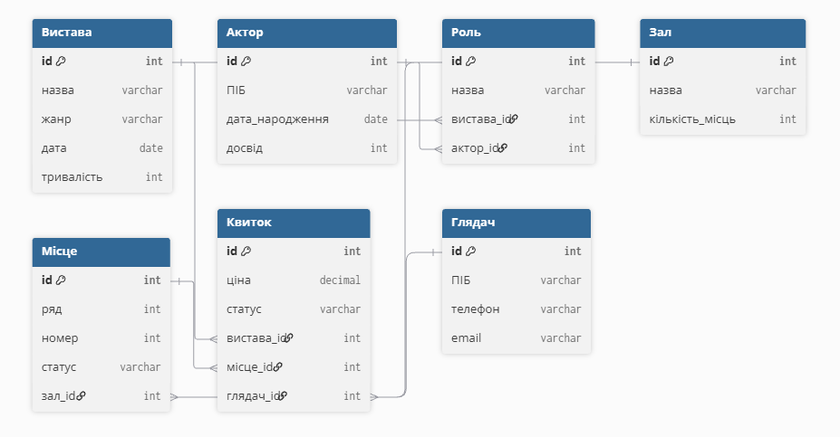
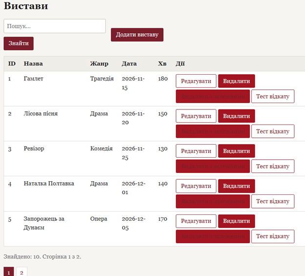
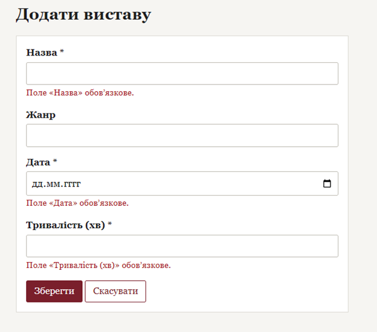
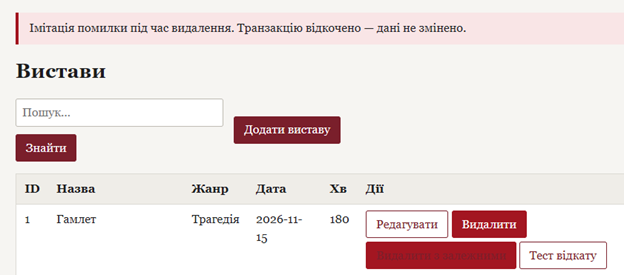

# Лабораторна робота №4 — CRUD-система «Театр»

**Автор:** Дорошенко Д. В., група КІ-251

## Опис
Веб-застосунок (PHP 8.3 + Apache) для керування БД «Театр» з ЛР №1–3: вистави, актори, ролі, зали, місця, глядачі, квитки.
Доступ до БД — через PDO (pdo_pgsql) лише з підготовленими запитами. СУБД — PostgreSQL 16 (як у ЛР №2–3).

## Запуск
```bash
cp .env.example .env        # за потреби змініть пароль
docker compose up -d --build
```
Сайт: http://localhost:8080/

Повне перестворення БД з нуля: `docker compose down -v`

## Таблиці
`performances`, `actors`, `roles` (зв'язок M:N вистави–актори), `halls`, `seats`, `viewers`, `tickets`.

## Реалізовано
- CRUD для всіх 7 сутностей (список з JOIN, створення, редагування, видалення POST-ом)
- Пошук (ILIKE) і пагінація (по 5 записів) (LIMIT/OFFSET через bindValue + PDO::PARAM_INT)
- Захист: SQL-ін'єкції (prepare/execute), XSS (htmlspecialchars → `h()`), CSRF-токен (419), серверна валідація (обов'язкові поля, довжина, формат, існування FK, дублікати 23505), PRG + flash
- Видалення залежних записів: або заборона з повідомленням (23503), або каскад у транзакції
- Транзакція: «Видалити з залежними» + кнопка «Тест відкату» (вистави) — показує rollback при помилці

## Структура
`public/<сутність>/{index,create,edit,delete}.php` → логіка в `src/crud.php` (конфігурація сутностей + обробники).

## ER-діаграма


Діаграма з ЛР №1 (назви українською). У БД таблиці названо англійською:
Вистава — `performances`, Актор — `actors`, Роль — `roles`, Зал — `halls`,
Місце — `seats`, Квиток — `tickets`, Глядач — `viewers`.

## Скриншоти
**Список з пошуком і пагінацією**



**Валідація форми**



**Відкат транзакції**

